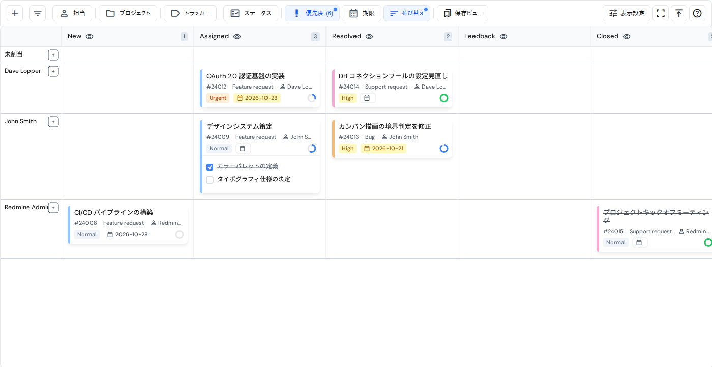
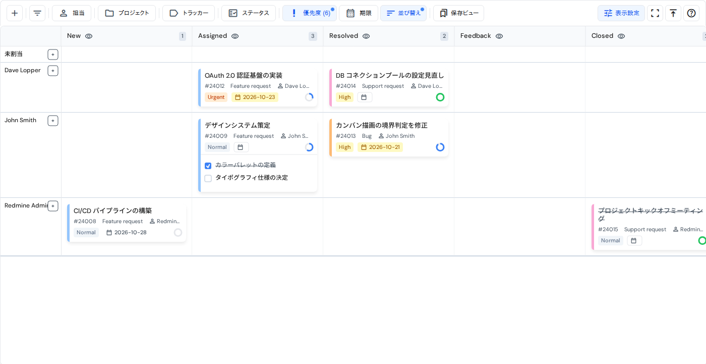
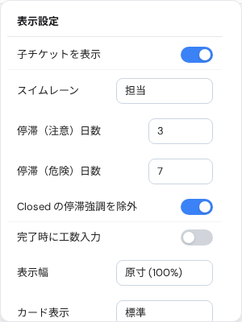

# Redmine Kanban

Redmine の運用を強化する、React + Vite で構築されたモダンなカンバンボードプラグインです。
個人ごとの表示設定と停滞検知により、日々のフローを見えやすくします。

> **公式マニュアル**: [日本語マニュアル](https://tiohsa.github.io/redmine_kanban/ja/) | [English manual](https://tiohsa.github.io/redmine_kanban/en/) | [English README](README.md)

## 目次

- [概要](#概要)
- [主な特徴](#主な特徴)
- [スクリーンショット](#スクリーンショット)
- [クイックスタート（Docker Compose）](#クイックスタートdocker-compose)
- [Redmine プラグインとして導入](#redmine-プラグインとして導入)
- [技術スタック](#技術スタック)
- [開発](#開発)
- [テスト](#テスト)
- [開発者向け資料](#開発者向け資料)
- [ライセンス](#ライセンス)

## 概要

Redmine Kanban は、作業の滞留を早期に可視化し、チームのフローを守るためのプラグインです。
直感的な操作感と高い描画性能により、日々の運用をスムーズにします。

## 主な特徴

- **Canvas 描画**: HTML Canvas による高パフォーマンスなボード描画。大量データでもスムーズ。
- **停滞検知 (Aging)**: 長期間更新されていないタスクを視覚的に強調。閾値は各ユーザーの表示設定として保存されます。
- **スイムレーン**: 担当者・優先度・カテゴリでレーンを切り替え可能（レーンなし表示にも対応）。
- **ドラッグ&ドロップ**: Redmine のワークフローに準拠したステータス遷移をサポート。子チケット表示エリア上からもカードをつかんで移動可能。
- **高度なフィルタリング**: トラッカー、担当者、期限、優先度、Blocked 状態などで絞り込み可能。表示するステータス列は、Statusフィルターで独立して選択します。
- **Kanban からの直接作成**: 列ヘッダやセルから新規チケットを作成可能。
- **再帰サブタスク表示**: 子・孫以降を含むサブタスク階層を表示できます。親チケット内にまとめて表示するか、子チケットを個別カードとして表示するかを切り替え可能で、完了状態も切り替えられます。
- **削除後の再作成**: 削除したトップレベルチケットを、表示中の件名、プロジェクト、説明、ステータス、担当者、トラッカー、優先度、開始日、期日、進捗率で再作成できます。子チケットは親なしのトップレベルチケットとして再作成しません。新しいチケットが作成され、元のID・履歴・コメント・添付・関連・ウォッチャーは復元されません。
- **プロジェクトフィルタ**: 複数プロジェクトやサブプロジェクトでフィルタリング可能。

## スクリーンショット





## クイックスタート（Docker Compose）

フルリポジトリを利用する場合は、リポジトリルートの Docker Compose を使用します。

```bash
cd ../..
docker compose up -d
```

アクセス先: [http://localhost:3002](http://localhost:3002)

- ログインID: `admin`
- パスワード: `admin`

## Redmine プラグインとして導入

既存の Redmine に導入する場合は、以下の手順で利用できます。

1. このプラグインを Redmine の `plugins/` 配下に `redmine_kanban` として配置。
2. Redmine を再起動。
3. 対象プロジェクトで **Kanban** モジュールを有効化。

フロントエンドを変更した場合は、`plugins/redmine_kanban/frontend` でビルドしてから再起動してください。

```bash
cd plugins/redmine_kanban/frontend
pnpm install
pnpm run typecheck
pnpm run build
```

## マニュアル

インストール、基本操作、表示設定、フィルター、保存ビュー、トラブルシューティングは[日本語マニュアル](https://tiohsa.github.io/redmine_kanban/ja/)を参照してください。

### 利用方法

[基本操作](website/ja/guide/basic-operations.md)を参照してください。

### 表示設定

[表示設定](website/ja/features/display-settings.md)を参照してください。

### 復旧と保存ビュー

[トラブルシューティングと復旧](website/ja/troubleshooting/index.md)および[保存ビュー](website/ja/features/saved-views.md)を参照してください。

## 技術スタック

| レイヤー | 技術 |
| --- | --- |
| バックエンド | Ruby on Rails (Redmine プラグイン) |
| フロントエンド（カンバン） | React 18 + TypeScript + Vite + Canvas |
| コンテナ | Docker Compose |
| データベース | PostgreSQL (Redmine 標準) |

## 開発

フロントエンド（SPA 部分）のソースコードは `plugins/redmine_kanban/frontend` にあります。

```bash
cd plugins/redmine_kanban/frontend
pnpm install
pnpm run test -- --run
pnpm run typecheck
pnpm run build
```

`pnpm` を使わない環境では `npm ci` / `npm run ...` でも実行できます（`frontend/package-lock.json` 同梱）。

seed済みのRedmineプロジェクトに対するTreeのresource指標は、次で再現できます。

```bash
REDMINE_KANBAN_BENCHMARK_PROJECT=ecookbook \
  docker compose -f .github/e2e/docker-compose.yml exec -T redmine \
  bundle exec rails runner -e production plugins/redmine_kanban/script/benchmark_tree.rb
```

ビルド完了後、Redmine コンテナを再起動して変更を反映します。

```bash
cd ../..
docker compose restart redmine
```

## テスト

バックエンド（Ruby）のテスト:

```bash
docker compose exec redmine bundle exec rails test plugins/redmine_kanban/test
```

フロントエンドのユニットテスト / 型チェック:

```bash
cd plugins/redmine_kanban/frontend
pnpm run test -- --run
pnpm run typecheck
```

Playwright E2E（ローカル実行）:

```bash
npm install --prefix e2e
npx --prefix e2e playwright install chromium

# Redmine 起動（プラグインルートで実行）
docker compose -f .github/e2e/docker-compose.yml up -d

# Redmine 初期化（初回）
docker compose -f .github/e2e/docker-compose.yml exec -T redmine \
  bundle exec rake db:migrate redmine:plugins:migrate RAILS_ENV=production
docker compose -f .github/e2e/docker-compose.yml exec -T redmine \
  env REDMINE_LANG=en bundle exec rake redmine:load_default_data RAILS_ENV=production
docker compose -f .github/e2e/docker-compose.yml exec -T --user redmine redmine \
  bundle exec rails runner -e production plugins/redmine_kanban/e2e/setup_redmine.rb

# E2E 実行
REDMINE_BASE_URL=http://127.0.0.1:3002 \
  npx --prefix e2e playwright test -c e2e/playwright.config.js
```

## 開発者向け資料

API仕様とCIの詳細は[開発者向け資料](DEVELOPMENT.ja.md)を参照してください。

### API エンドポイント

[開発者向け資料のAPI エンドポイント](DEVELOPMENT.ja.md#api-エンドポイント)を参照してください。

### CI

[開発者向け資料のCI](DEVELOPMENT.ja.md#ci)を参照してください。

## ライセンス

プラグインコードは GPLv2 です。同梱フォントのライセンスは [THIRD_PARTY_LICENSES.md](THIRD_PARTY_LICENSES.md) を参照してください。

