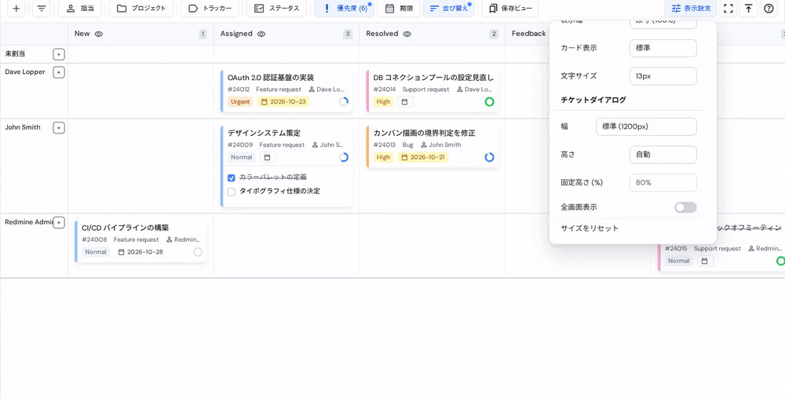
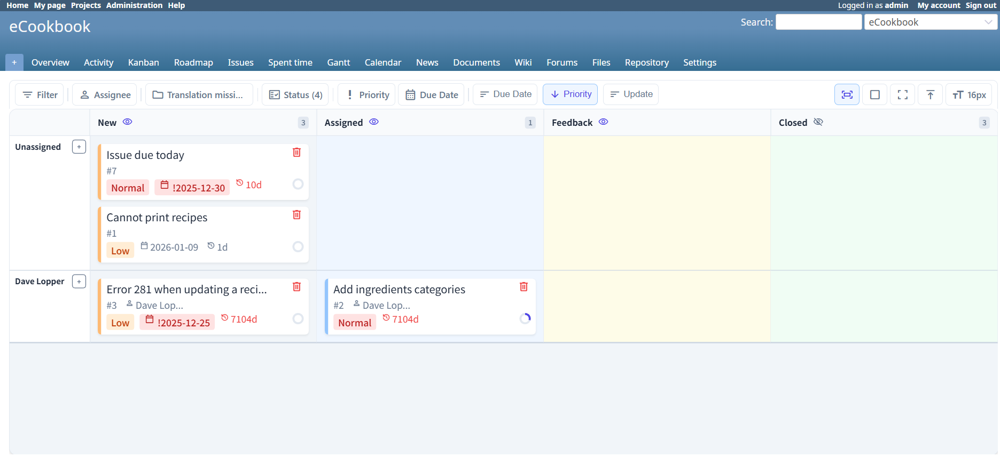
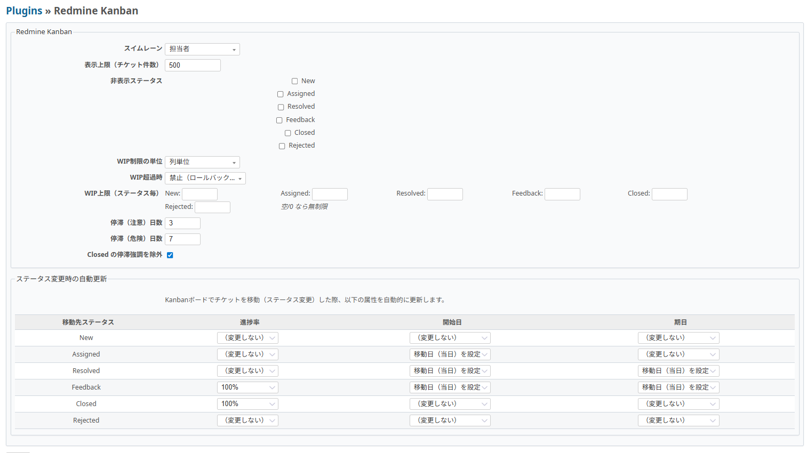

# Redmine Kanban

Redmine の運用を強化する、React + Vite で構築されたモダンなカンバンボードプラグインです。
個人ごとの表示設定と停滞検知により、日々のフローを見えやすくします。

> **公式マニュアル**: [日本語マニュアル](https://tiohsa.github.io/redmine_kanban/ja/) | [English manual](https://tiohsa.github.io/redmine_kanban/en/) | [English README](README.md)

## 目次

- [概要](#概要)
- [主な特徴](#主な特徴)
- [スクリーンショット](#スクリーンショット)
- [クイックスタート（Docker Compose）](#クイックスタートdocker-compose)
- [Redmine プラグインとして導入](#redmine-プラグインとして導入)
- [技術スタック](#技術スタック)
- [開発](#開発)
- [テスト](#テスト)
- [API エンドポイント](#api-エンドポイント)
- [CI](#ci)
- [ライセンス](#ライセンス)

## 概要

Redmine Kanban は、作業の滞留を早期に可視化し、チームのフローを守るためのプラグインです。
直感的な操作感と高い描画性能により、日々の運用をスムーズにします。

## 主な特徴

- **Canvas 描画**: HTML Canvas による高パフォーマンスなボード描画。大量データでもスムーズ。
- **停滞検知 (Aging)**: 長期間更新されていないタスクを視覚的に強調。閾値は各ユーザーの表示設定として保存されます。
- **スイムレーン**: 担当者・優先度・カテゴリでレーンを切り替え可能（レーンなし表示にも対応）。
- **ドラッグ&ドロップ**: Redmine のワークフローに準拠したステータス遷移をサポート。子チケット表示エリア上からもカードをつかんで移動可能。
- **高度なフィルタリング**: トラッカー、担当者、期限、優先度、Blocked 状態などで絞り込み可能。表示するステータス列は、Statusフィルターで独立して選択します。
- **Kanban からの直接作成**: 列ヘッダやセルから新規チケットを作成可能。
- **再帰サブタスク表示**: 子・孫以降を含むサブタスク階層を表示できます。親チケット内にまとめて表示するか、子チケットを個別カードとして表示するかを切り替え可能で、完了状態も切り替えられます。
- **削除後の再作成**: 削除したトップレベルチケットを、表示中の件名、プロジェクト、説明、ステータス、担当者、トラッカー、優先度、開始日、期日、進捗率で再作成できます。子チケットは親なしのトップレベルチケットとして再作成しません。新しいチケットが作成され、元のID・履歴・コメント・添付・関連・ウォッチャーは復元されません。
- **プロジェクトフィルタ**: 複数プロジェクトやサブプロジェクトでフィルタリング可能。

## スクリーンショット





## クイックスタート（Docker Compose）

フルリポジトリを利用する場合は、リポジトリルートの Docker Compose を使用します。

```bash
cd ../..
docker compose up -d
```

アクセス先: [http://localhost:3002](http://localhost:3002)

- ログインID: `admin`
- パスワード: `admin`

## Redmine プラグインとして導入

既存の Redmine に導入する場合は、以下の手順で利用できます。

1. このプラグインを Redmine の `plugins/` 配下に `redmine_kanban` として配置。
2. Redmine を再起動。
3. 対象プロジェクトで **Kanban** モジュールを有効化。

フロントエンドを変更した場合は、`plugins/redmine_kanban/frontend` でビルドしてから再起動してください。

```bash
cd plugins/redmine_kanban/frontend
pnpm install
pnpm run typecheck
pnpm run build
```

## マニュアル

インストール、基本操作、表示設定、フィルター、保存ビュー、トラブルシューティングは[日本語マニュアル](https://tiohsa.github.io/redmine_kanban/ja/)を参照してください。

## 技術スタック

| レイヤー | 技術 |
| --- | --- |
| バックエンド | Ruby on Rails (Redmine プラグイン) |
| フロントエンド（カンバン） | React 18 + TypeScript + Vite + Canvas |
| コンテナ | Docker Compose |
| データベース | PostgreSQL (Redmine 標準) |

## 開発

フロントエンド（SPA 部分）のソースコードは `plugins/redmine_kanban/frontend` にあります。

```bash
cd plugins/redmine_kanban/frontend
pnpm install
pnpm run test -- --run
pnpm run typecheck
pnpm run build
```

`pnpm` を使わない環境では `npm ci` / `npm run ...` でも実行できます（`frontend/package-lock.json` 同梱）。

seed済みのRedmineプロジェクトに対するTreeのresource指標は、次で再現できます。

```bash
REDMINE_KANBAN_BENCHMARK_PROJECT=ecookbook \
  docker compose -f .github/e2e/docker-compose.yml exec -T redmine \
  bundle exec rails runner -e production plugins/redmine_kanban/script/benchmark_tree.rb
```

ビルド完了後、Redmine コンテナを再起動して変更を反映します。

```bash
cd ../..
docker compose restart redmine
```

## テスト

バックエンド（Ruby）のテスト:

```bash
docker compose exec redmine bundle exec rails test plugins/redmine_kanban/test
```

フロントエンドのユニットテスト / 型チェック:

```bash
cd plugins/redmine_kanban/frontend
pnpm run test -- --run
pnpm run typecheck
```

Playwright E2E（ローカル実行）:

```bash
npm install --prefix e2e
npx --prefix e2e playwright install chromium

# Redmine 起動（プラグインルートで実行）
docker compose -f .github/e2e/docker-compose.yml up -d

# Redmine 初期化（初回）
docker compose -f .github/e2e/docker-compose.yml exec -T redmine \
  bundle exec rake db:migrate redmine:plugins:migrate RAILS_ENV=production
docker compose -f .github/e2e/docker-compose.yml exec -T redmine \
  env REDMINE_LANG=en bundle exec rake redmine:load_default_data RAILS_ENV=production
docker compose -f .github/e2e/docker-compose.yml exec -T --user redmine redmine \
  bundle exec rails runner -e production plugins/redmine_kanban/e2e/setup_redmine.rb

# E2E 実行
REDMINE_BASE_URL=http://127.0.0.1:3002 \
  npx --prefix e2e playwright test -c e2e/playwright.config.js
```

## API エンドポイント

| メソッド | パス | 説明 |
| --- | --- | --- |
| GET | `/projects/:project_id/kanban/data` | ボードデータ取得 |
| PATCH | `/projects/:project_id/kanban/issues/:id/move` | カード移動 |
| POST | `/projects/:project_id/kanban/issues` | チケット作成 |
| POST | `/projects/:project_id/kanban/issues/bulk` | 親チケットと子チケット、または既存親への子チケット一括作成 |
| PATCH | `/projects/:project_id/kanban/issues/:id` | チケット更新 |
| DELETE | `/projects/:project_id/kanban/issues/:id` | チケット削除 |
| GET | `/projects/:project_id/kanban/issues/entities?ids[]=...` | 指定Issue Entityの再同期 |

ボードデータ補足:

- contract version 3は `entities` にIssueを一意に返し、`tree.root_ids` と `tree.children_by_parent_id` から関係を表現します。Frontendはnormalized stateからCanvas用の行を派生します。
- Requestの件数パラメータは `board_entity_limit` です。`issue_limit`、`offset`、`cursor`、`tree_parent_id` はHTTP 400で拒否され、部分snapshotが成功として返ることはありません。
- mutation responseはcontract version 3のflat delta（`operation_id`、`scope_fingerprint`、`issue_updates`、`created_issues`、`deleted_issue_ids`、`tree_changes`、`invalidations`）を返し、FrontendはEntity／Tree共通Reducerでnormalized stateへ適用し、対象Issueの再同期にはentities endpointを使います。
- `lists.trackers` には、既存の `id/name` に加えて `workflow_status_ids`、`default_status_id`、`available_project_ids` を返します。トラッカーフィルターはIssue membershipを絞り、表示するColumnはStatus filterで独立して選択します。Status移動の可否はRedmine Workflow metadata（`allowed_status_ids`）とサーバー側の検証で決まります。選択中のトラッカーが1件で作成先プロジェクトでも利用可能な場合だけ、Native Redmineの作成画面へ引き継ぎます。
- Frontendの表示ルートは、filter済みtreeから表示用に派生します。明示的なStatus filterや`hiddenStatusIds`によりcontext親を表示できない場合、保持された表示可能な子孫をカードとして表示します。canonicalな`parent_id`やnormalized treeは変更しません。表示可能なcontext親は階層内に残り、子孫表示用・context専用ColumnはCreate候補に含めません。
- Toolbar/Lane Header Createは、利用可能な単一Trackerのdefault status、最初のopen、最初のcandidateの順で選びます。context専用Columnは候補に含めず、候補が空の場合は固定Statusへfallbackせず作成操作を無効化します。
- ドラッグ中の色や記号はsnapshot時点のワークフロー参考情報で、threshold超過後に表示中の全セルへ表示します（`✓`は許可、`!`はsnapshotとの不一致・参考情報、`?`は不明）。同一セルへのNOOPとカテゴリを変更するdropは送信せず、それ以外は許可・拒否・不明の参考情報にかかわらず既存のMutation経路へ渡してRedmineを最終Authorityとします。カテゴリレーン間の移動は、カテゴリなしへの移動・カテゴリなしからの移動を含めて禁止し、許可対象のhighlightやdrop previewを表示せず、Mutationも送信しません。同一カテゴリレーン内のStatus移動は既存のWorkflow経路を使います。ワークフロー拒否時は自動再試行せず、`WORKFLOW_TRANSITION_NOT_ALLOWED` を使って対象Issueを一度だけ再同期します。
- Physical Deleteの`deleted_issue_ids`は、現在のBoardから観測可能で実際に削除されたcascade集合を表します。scopeから外れただけのIssueは`evicted_issue_ids`に分離し、完全なbounded deltaを作れない場合はpartial tombstoneではなくBoard snapshot invalidationへfallbackします。Undoで再作成するのは要求されたトップレベルIssueだけです。
- カード移動は、祖先・dependencyのmembershipへの追加や除外を含め、適用中のIssue filterをbounded deltaで同期し、Board全体を再取得しません。filter付き移動と同じBoardへの別の書き込みが重なる場合、Frontendはoptimistic表示を維持して重複するdeltaの適用を保留し、全書き込み完了後にauthoritative snapshotを一度取得します。完全なdeltaが資源上限を超える場合は、成功済み移動を維持したままsnapshotをinvalidateして復旧します。
- `scope_fingerprint` はboard project、current user、sanitized project scope、primary status scope、dependency status scopeを表すopaqueな識別子であり、hashの具体的な値は公開された互換性契約ではありません。plugin mutationは同じscope/admissionパラメータを使います。Redmine標準iframeのIssue/journal保存はtrusted deltaを生成できないため、bulk子チケットを含む成功操作の最後に現在のboard queryを一度だけresetし、完全snapshotへ収束させます。保存後のrefresh失敗は保存失敗ではなくBoard読み込みエラーとして扱います。
- Issue responseは、`lock_version`／`updated_on`のfreshnessがcached Entityより古くない場合だけ適用します。optimistic更新の失敗時は、そのMutationのoptimistic値が残るfieldだけをrollbackし、Mutationが重複する場合は対象Issueをサーバーと再同期します。
- 削除後の再作成は、Issue階層上のトップレベルIssueだけが対象です。表示中の件名、Project、説明、Status、担当者、Tracker、Priority、日付、進捗率を使って新しいIssueを作成し、子Issueを親なしでは再作成しません。

一括作成の冪等性は `Rails.cache` で管理します。cache identity はユーザー・プロジェクト・操作・`Idempotency-Key`・canonical request payload digest で識別されます。atomicなclaimに成功した処理だけが作成処理を実行し、同じキーでも異なるpayloadは409、同一payloadのcompletedは以前のresponseを返します。クライアントは同一ブラウザセッション中の同一論理操作で同じキーを再利用し、入力検証失敗または例外時はclaimを削除して再試行できます。

一括作成は、空でない子チケットを1リクエストあたり50件まで受け付けます。51件以上のリクエストは、transaction開始前に拒否します。

保証範囲は、同一ブラウザの二重送信、ブラウザセッション中の同一論理操作の再試行、同一Redmineプロセス内の重複claim、およびatomicな共有 `CacheStore` の `unless_exist` 書き込みを使う複数プロセス間の重複claim防止です。プロセス分離されたMemoryStore、キャッシュ消失、サーバー再起動をまたぐ永続的なexactly-onceは保証しません。

このプラグインは特徴としてデータベースマイグレーションや独自テーブルを追加しません。キャッシュ消失、サーバー再起動、プロセスごとのMemoryStoreなど共有されないStoreでは、永続的なexactly-once保証はできません。より強い保証が必要な環境では、共有atomic/persistent CacheStoreまたは外部Idempotencyサービスを提供してください。

## CI

GitHub Actions ワークフロー: `.github/workflows/e2e-kanban.yml`

CI では以下を実行します。

- frontend の `build`
- frontend の `lint`
- frontend の `typecheck`
- Vitest による frontend unit test
- Redmine 7.0/MariaDB 上でのRuby/API全体テストとsnapshot contract gate
- PostgreSQL 16上のmembership/admission integration（unit suiteとfocused API suiteをRails test selectorごとに分離）
- Redmine 7.0 および Redmine 6.1 上でのPlaywright E2E（Redmine標準iframe保存、snapshot reset、再取得を含む）
- Redmine 6.0 上での Playwright 互換 smoke test
- `board_data_test.rb`、`snapshot_limits_test.rb`、`api_controller_test.rb` によるdeep-tree、exact-limit dependency、response byte、queryのdeterministic gate
- Redmine 7.0の実DBに1,505件の子Issueを生成するlarge-data gate。limit/over-limit admission、Issue一意性、materialized row、query数、response bytes、partial entitiesなしを検証

通常のRedmine test/browser jobは `.github/e2e/docker-compose.yml` のMariaDB 10を使い、PostgreSQL gateは `.github/e2e/docker-compose.postgres.yml` を使います。ブラウザ系jobはmigration、初期データ投入、`e2e/setup_redmine.rb` による `ecookbook` とnative専用 `kanban-native` のシード、Playwrightレポートのuploadまで実行します。

検証entry pointは `script/ci/` に集約しています。`ruby-full.sh`、`snapshot-contract.sh`、`postgres-unit.sh`、`postgres-api.sh`、`e2e-full.sh`、`native-mutation-e2e.sh`、`large-data-e2e.sh`、`compatibility-smoke.sh`を、ローカルのRedmineコンテナ実行とCIで共通利用します。

## ライセンス

プラグインコードは GPLv2 です。同梱フォントのライセンスは [THIRD_PARTY_LICENSES.md](THIRD_PARTY_LICENSES.md) を参照してください。

