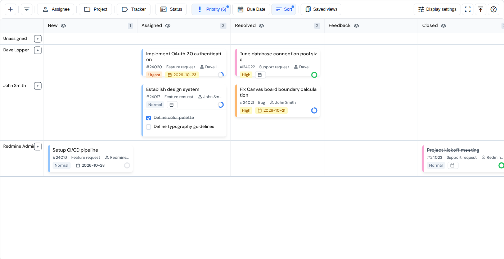
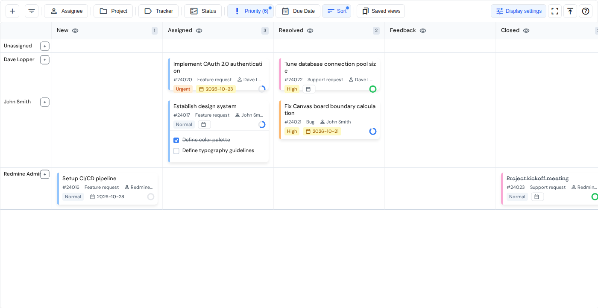
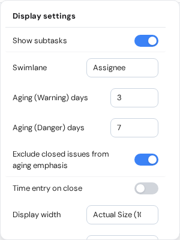

# Redmine Kanban

Modern Kanban board plugin for Redmine, built with React + Vite.
It provides task visualization, per-user display preferences, aging detection, and flow-focused controls.

> **Documentation**: [English manual](https://tiohsa.github.io/redmine_kanban/en/) | [日本語マニュアル](https://tiohsa.github.io/redmine_kanban/ja/) | [日本語版README](README.ja.md)

## Table of Contents

- [Overview](#overview)
- [Key Features](#key-features)
- [Screenshots](#screenshots)
- [Quick Start (Docker Compose)](#quick-start-docker-compose)
- [Install as a Redmine Plugin](#install-as-a-redmine-plugin)
- [Technology Stack](#technology-stack)
- [Development](#development)
- [Testing](#testing)
- [Developer reference](#developer-reference)
- [License](#license)

## Overview

Redmine Kanban helps teams keep flow healthy and visible by exposing stalled work and letting teams move issues quickly with minimal friction.

## Key Features

- **Canvas-Based Rendering**: High-performance board rendering using HTML Canvas for smooth scrolling and large dataset handling.
- **Aging Detection**: Highlight tasks that have not been updated for a long time. Thresholds are stored in each user's display preferences.
- **Swimlanes**: Switch lanes by assignee, priority, or category (or disable lanes for a single-row board).
- **Drag & Drop**: Intuitive card movement with Redmine workflow-aware status transitions. Cards can also be grabbed from the subtask area.
- **Advanced Filtering**: Filter issues by tracker, assignee, due date, priority, blocked status, and more. Choose visible status columns independently with the Status filter.
- **Direct Creation from Board**: Create new tickets from column headers or cells during standups.
- **Nested Subtask Display**: View subtasks recursively (child / grandchild / deeper) either inside parent cards or as separate cards, and toggle completion.
- **Recreate Deleted Issue**: Recreate a deleted top-level issue with the displayed content. It creates a new issue; history, comments, attachments, relations, watchers, and the original ID are not restored.
- **Project Filter**: Filter across projects and subprojects.

## Screenshots





## Quick Start (Docker Compose)

If you cloned the full repository, use the Docker Compose environment from the repo root:

```bash
cd ../..
docker compose up -d
```

Access Redmine at [http://localhost:3002](http://localhost:3002) with:

- Login: `admin`
- Password: `admin`

## Install as a Redmine Plugin

Use these steps when you want to install the plugin into an existing Redmine instance:

1. Copy this plugin into your Redmine `plugins/` directory as `redmine_kanban`.
2. Restart Redmine.
3. In Redmine, enable the **Kanban** module for your project.

If you modify the frontend, build assets from `plugins/redmine_kanban/frontend` before restarting:

```bash
cd plugins/redmine_kanban/frontend
pnpm install
pnpm run typecheck
pnpm run build
```

## User documentation

See the [English manual](https://tiohsa.github.io/redmine_kanban/en/) for installation, board operations, display settings, filtering, saved views, and troubleshooting.

### Usage

See [basic board operations](website/en/guide/basic-operations.md).

### Display preferences

See [display settings](website/en/features/display-settings.md).

### Recovery and saved views

See [troubleshooting and recovery](website/en/troubleshooting/index.md) and [saved views](website/en/features/saved-views.md).

## Technology Stack

| Layer | Technology |
| --- | --- |
| Backend | Ruby on Rails (Redmine plugin) |
| Frontend | React 18 + TypeScript + Vite + Canvas |
| Container | Docker Compose |
| Database | PostgreSQL (Redmine standard) |

## Development

Frontend source code is in `plugins/redmine_kanban/frontend`.

```bash
cd plugins/redmine_kanban/frontend
pnpm install
pnpm run test -- --run
pnpm run typecheck
pnpm run build
```

If your environment does not use `pnpm`, `npm ci` / `npm run ...` also works (`frontend/package-lock.json` is included).

To capture reproducible tree resource metrics against a seeded Redmine project:

```bash
REDMINE_KANBAN_BENCHMARK_PROJECT=ecookbook \
  docker compose -f .github/e2e/docker-compose.yml exec -T redmine \
  bundle exec rails runner -e production plugins/redmine_kanban/script/benchmark_tree.rb
```

Restart the Redmine container after rebuilding assets:

```bash
cd ../..
docker compose restart redmine
```

## Testing

Backend (Ruby) tests:

```bash
docker compose exec redmine bundle exec rails test plugins/redmine_kanban/test
```

Frontend unit tests / type checking:

```bash
cd plugins/redmine_kanban/frontend
pnpm run test -- --run
pnpm run typecheck
```

Playwright E2E (local):

```bash
npm install --prefix e2e
npx --prefix e2e playwright install chromium

# Start Redmine stack (from plugin root)
docker compose -f .github/e2e/docker-compose.yml up -d

# Initialize Redmine data (first run)
docker compose -f .github/e2e/docker-compose.yml exec -T redmine \
  bundle exec rake db:migrate redmine:plugins:migrate RAILS_ENV=production
docker compose -f .github/e2e/docker-compose.yml exec -T redmine \
  env REDMINE_LANG=en bundle exec rake redmine:load_default_data RAILS_ENV=production
docker compose -f .github/e2e/docker-compose.yml exec -T --user redmine redmine \
  bundle exec rails runner -e production plugins/redmine_kanban/e2e/setup_redmine.rb

# Run E2E
REDMINE_BASE_URL=http://127.0.0.1:3002 \
  npx --prefix e2e playwright test -c e2e/playwright.config.js
```

## Developer reference

API contracts and CI details for contributors are in [the developer reference](DEVELOPMENT.md).

### API Endpoints

See [API endpoints in the developer reference](DEVELOPMENT.md#api-endpoints).

### CI

See [CI in the developer reference](DEVELOPMENT.md#ci).

## License

Plugin code: GPLv2. Bundled third-party fonts: see [THIRD_PARTY_LICENSES.md](THIRD_PARTY_LICENSES.md).

This project is licensed under the GNU General Public License v2.0 (GPLv2).
