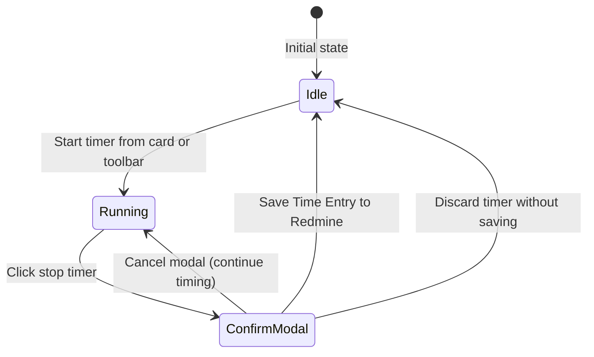

# Work Timer

Track work on an issue and save the elapsed time as a Redmine Time Entry.

## Timer Capabilities

- **Global Toolbar Timer**: Displays live elapsed time in `HH:MM:SS` format on the top toolbar.
- **Card-Triggered Start**: Start timing an issue immediately from the action menu on any card.
- **Cross-Tab Awareness**: Alerts you if a timer is running in another browser tab, helping prevent double timing.

---

## Timer Lifecycle

### 1. Starting the Timer (TimerStartModal)
- Verify the target issue subject and ID.
- Optionally select the appropriate activity classification and click **Start**.

### 2. Active Timing (GlobalTimer)
- The toolbar counter ticks upwards in real time.
- You can freely navigate, browse other issues, and move cards while the timer runs in the background.

### 3. Stopping and Logging Time (PendingWorkModal)
- Clicking the stop button opens the time entry submission modal.
- The elapsed duration is automatically converted into decimal hours (e.g., 1.5 hours).
- Enter comments, verify the date and activity type, and submit.
- The record is saved as a standard Redmine Time Entry and immediately updates the issue's total spent hours.

---

## Security and Integrity

- **Permissions**: Starting the timer and logging time require Redmine's `Log time` permission.
- **Duplicate Protection**: The browser manages timer state to prevent duplicate submissions during retries and session recovery.
