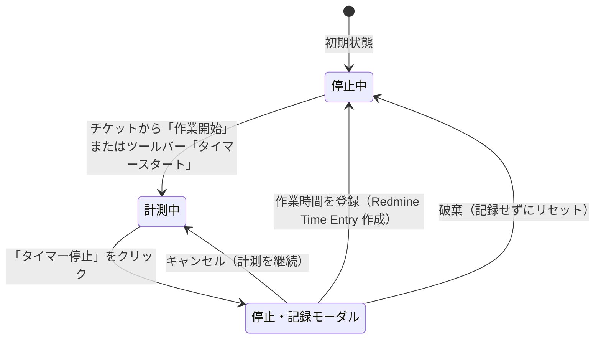

# 作業時間タイマー（Work Timer）

作業時間タイマーでチケットの作業時間を計測し、Redmine の作業時間として登録できます。

## タイマーの主な機能

- **グローバルタイマー（ツールバー）**: 画面右上に現在の計測状態と経過時間が常時表示されます。
- **カードから開始**: カードのアクションで「作業を開始」を選ぶと、そのチケットのタイマーを起動できます。
- **他タブのタイマー検出**: 別のタブやウィンドウで計測中なら通知し、二重計測を防ぎます。

---

## タイマーのライフサイクル

### 1. タイマーの開始（TimerStartModal）
- 対象のチケット番号と件名を確認します。
- 必要に応じて活動（Activity）を選択し、「スタート」を押します。

### 2. 計測中（GlobalTimer）
- ツールバー上で経過時間（HH:MM:SS）がリアルタイムにカウントアップされます。
- 作業中はいつでも他のチケットの閲覧やドラッグ＆ドロップ移動が可能です。

### 3. タイマーの停止と作業時間記録（PendingWorkModal）
- 作業終了時にタイマー停止ボタンを押すと、記録確認ダイアログが表示されます。
- 経過時間を時間単位（例: 1.5 時間）に自動換算します。
- 作業分類（活動）、作業日、コメントを入力し、「登録」をクリックします。
- Redmine の標準作業時間記録としてサーバーに保存され、チケットの総作業時間に直ちに合算されます。

---

## 権限と安全設計

- **権限チェック**: タイマーの開始・登録には、プロジェクトの「作業時間の記録（Log time）」権限が必要です。
- **二重登録の防止**: 通信エラーや再試行時に同じ作業時間を重複送信しないよう、ブラウザーで計測状態を管理します。
